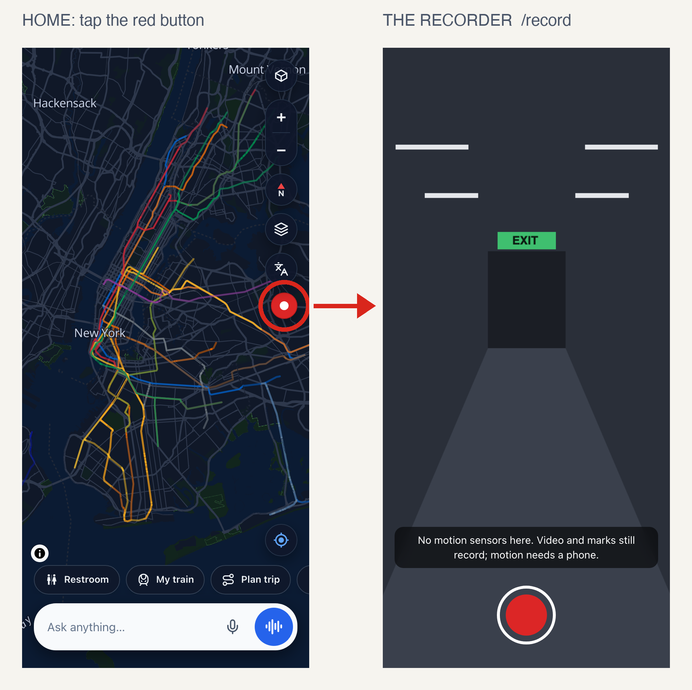
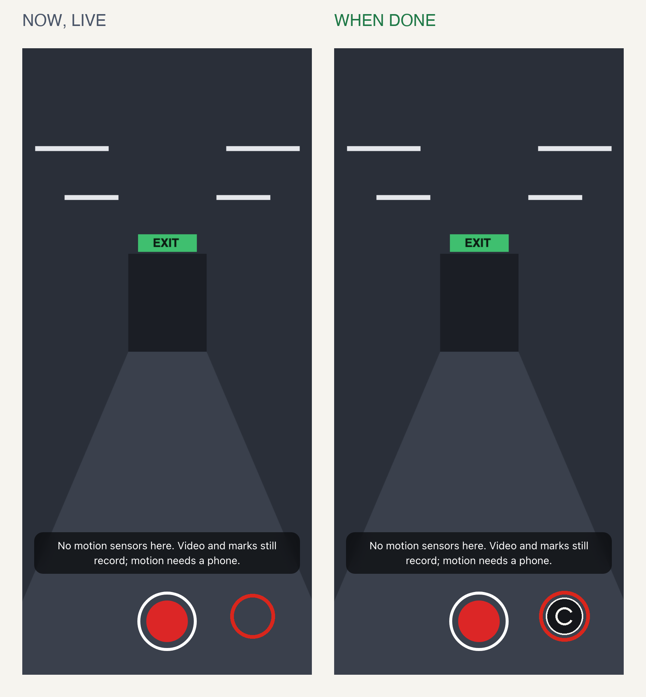
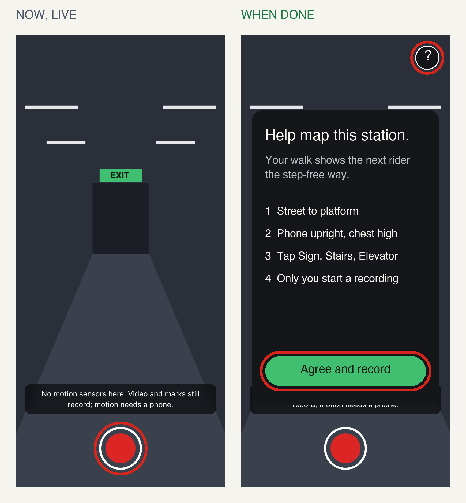
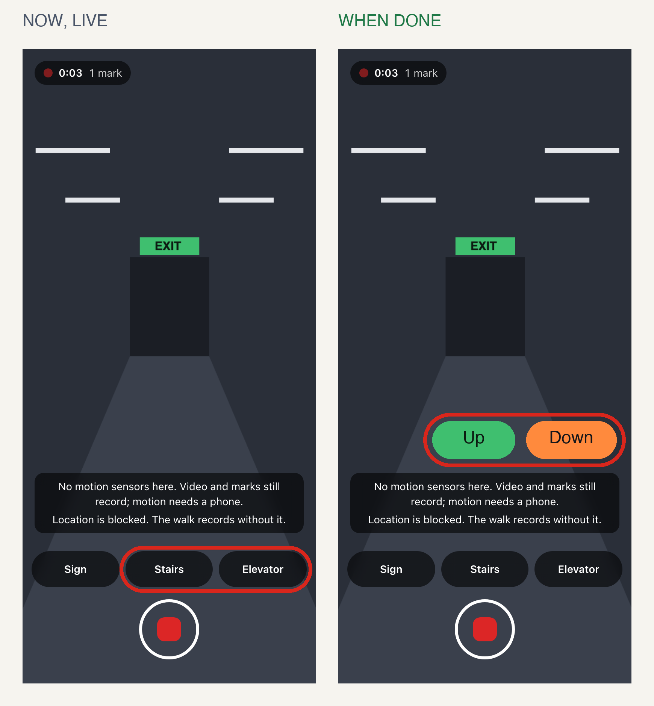
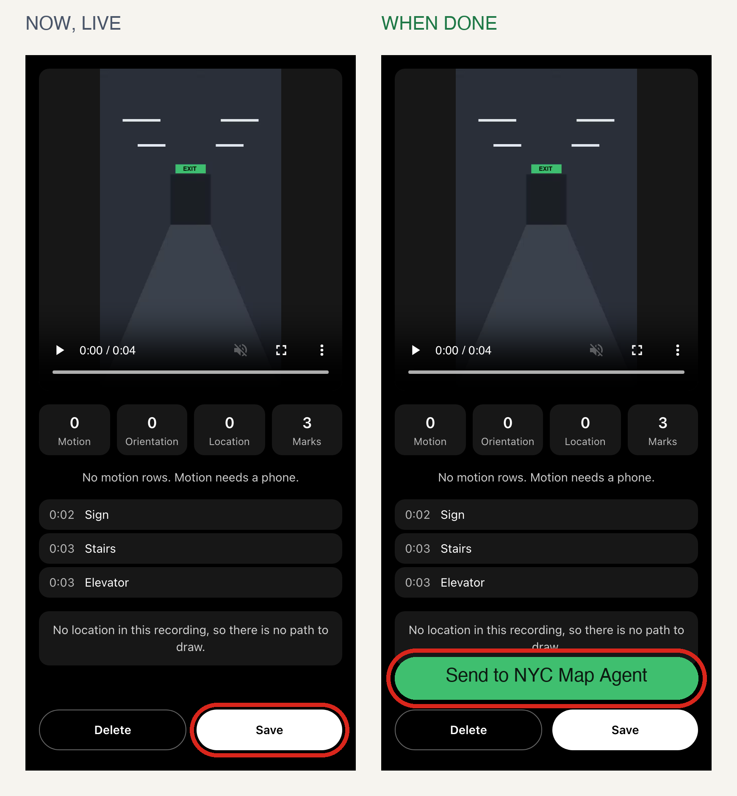

# Recorder contributions: what the checks expect

This is the contract for the work on issue #223 (camera switch, first-time screens, up or down on marks, send in one tap). The checks in `src/features/recorder/record/contract.test.ts` and `e2e/record-contribute.spec.ts` are written from it. They are skipped while a piece does not exist and switch on by themselves when its file or its control appears, so a pull request that adds a piece is checked without anyone wiring anything.

If a name below does not suit the code you write, change the name here and in the test in the same pull request and say why in its description. Do not delete a property to make a check pass.

## How the checks switch on

| Piece | Unit checks switch on when | Browser checks switch on when |
| --- | --- | --- |
| 1 Switch camera | `camera.ts` exports `nextCamera` | the record screen has `data-testid="switch-camera"` |
| 2 First-time screens | (none) | a first visit shows `data-testid="record-intro"` |
| 3 Up or down | `levels.ts` exists and exports `levelsFromMarks` | a Stairs tap shows `data-testid="mark-up"` |
| 4 Send | `upload.ts` exists and exports `chunkPlan` and `checkUpload` | the review screen has `data-testid="review-send"` |

## Functions

```ts
// camera.ts
/** The camera after `current` in the device's list, wrapping round; null when there is nothing to switch to. */
nextCamera(devices: { deviceId: string }[], current: string | null): string | null

// levels.ts
type Dir = "up" | "down";
/** A stairs or elevator mark carries which way: `dir` on the mark. A mark without it changes nothing. */
levelsFromMarks(marks: { t: number; kind: "sign" | "stairs" | "elevator"; dir?: Dir }[], start: number): { t: number; level: number }[]
// One entry per level change, in time order: the level the rider is on from time t.

// upload.ts
/** The byte ranges [from, to) still to send, in order, for a file of `size` when `confirmed` bytes are already stored. */
chunkPlan(size: number, chunk: number, confirmed?: number): [number, number][]
/** Null when the upload may go; otherwise one plain sentence saying why not. */
checkUpload(a: { bytes: number; sentToday: number }, limits: { maxBytes: number; perDay: number }): string | null
```

## Properties (the unit checks)

These hold for any input, so the tests generate inputs instead of listing cases.

**Camera**
- One camera, or none: nothing to switch to.
- Pressing switch as many times as there are cameras returns to the first, and visits each camera once.
- A current camera that is no longer in the list moves to the first.

**Levels**
- No stairs or elevator marks: no level change, whatever the signs.
- Shifting every time by the same amount shifts the answers by that amount and changes no level.
- Up then down ends where it started.
- Adding sign marks anywhere changes nothing.
- A walk in two halves: the levels of the whole are the levels of the first half, then the levels of the second half started from where the first ended.
- The same walk backwards, with every direction flipped, passes the same levels in reverse.
- A stairs or elevator mark with no direction changes nothing.

**Upload**
- The ranges cover the file from `confirmed` to the end with no gap and no overlap, and none is longer than the chunk size.
- Resuming from any confirmed point gives exactly the tail of the full plan.
- A file already fully confirmed has nothing left to send.
- A file over the size limit, or a sender over the daily limit, is refused with a sentence; one inside both limits is allowed.

## Scenarios (the browser checks)

**Switch camera.** Given a device with two cameras, when the rider opens the recorder, then a switch control is shown; when they press it, then the page asks for the other camera; and the layout check passes. Given one camera, then no control is shown.

**First-time screens.** Given a first visit, when the recorder opens, then the intro is shown before any recording; when the rider agrees, then the camera is live and the intro is gone; given a second visit, then the intro is not shown and a "How to record" control brings it back.

**Up or down.** Given a recording in progress, when the rider taps Stairs, then Up and Down are offered; when they tap Down, then the saved recording's stairs mark says down.

**Send.** Given a finished recording, when the rider presses Send, then the recording's JSON is the first thing uploaded, and the screen says it was sent. Given the server refuses, then the screen says so and the recording is still there to send again or save. The browser check presses Save before it looks for the file links: "or save" means the button is there to press, not that a refusal saves by itself.

## What these checks do not cover

A real phone's cameras and sensors, a real dropped connection, how the upload behaves with a large video, and whether the screens read well. The owner checks those by hand on each pull request.

## Pictures: the live screen, and the screen when each piece is done

Left is the live recorder at phone size on 2026-11-16 (the camera picture is a stand-in drawing). Right is the same screen with the requested control drawn on. Red circles mark where to look. The right-hand pictures are sketches of what is asked for, not designs to copy pixel for pixel.

| Piece | Picture |
| --- | --- |
| Where the recorder is |  |
| 1 Switch camera |  |
| 2 First-time screens |  |
| 3 Up or down |  |
| 4 Send |  |
